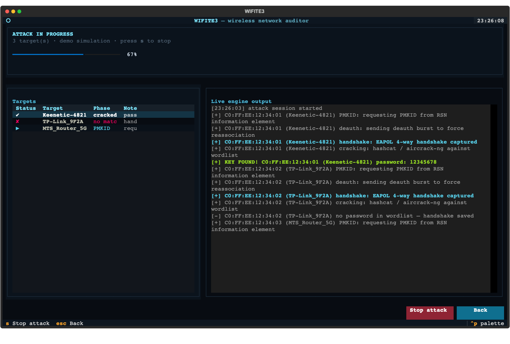

# Wifite3

**Современный TUI-аудитор Wi-Fi для Linux.** Внутри — движок
[Wifite2](https://github.com/kimocoder/wifite2) (WPA/WPA2/WPA3, PMKID, WPS,
WEP, OWE, Evil Twin, dual-interface), снаружи — удобный интерфейс и установка
без изменений системного Python.

> ⚠️ **Только для своих сетей.** Используйте Wifite3 только на сетях, которыми
> владеете или на тестирование которых есть письменное разрешение.
> Несанкционированный перехват трафика незаконен.

```
  ██╗    ██╗██╗███████╗██╗████████╗███████╗██████╗      ██████╗
  ██║    ██║██║██╔════╝██║╚══██╔══╝╔════╝╚════██╗    ╚════██║
  ██║ █╗ ██║██║█████╗  ██║   ██║   █████╗    █████╔╝      █████╔╝
  ██║███╗██║██║██╔══╝   ██║   ██║   ██╔══╝   ██╔═══╝      ╚════██║
  ╚███╔███╔╝██║██╔══╝   ██║   ██║   ███████╗██████╗      ██████╔╝
   ╚══╝╚══╝  ╚═╝ ╚═════╝╚═╝   ╚═╝   ╚══════╝╚══════╝     ╚═════╝
```

## Скриншоты

Главный экран: сканирование, фильтр, сортировка, выбор целей и карточка сети.


Атака: прогресс по целям и живой вывод движка (PMKID, handshake, cracking).



## Что уже есть

- **Движок Wifite2** — WPA/WPA2/WPA3, PMKID, WPS, WEP, OWE, Evil Twin и
  dual-interface. Оригинальные компоненты и лицензия указаны в [NOTICE](NOTICE).
- **Textual TUI** — таблица сетей с сортировкой и фильтром, выбор целей,
  live-лог атаки, панель деталей и progress bar.
- **Живой ввод** — запросы движка (`wordlist`, подтверждение) открываются
  в модальном окне.
- **Остановка атаки** — Stop отправляет событие остановки, прерывает worker
  и завершает дочерние процессы.
- **`--doctor`** — диагностика Linux, root, адаптеров, monitor mode,
  `rfkill`, инструментов и данных.
- **Безопасная установка** — `install.sh` определяет Fedora / Ubuntu / Debian /
  Arch / openSUSE и ставит Python-приложение в изолированный root-owned venv
  `/opt/wifite3` (PEP 668).
- **`--demo`** — интерфейс и симуляция без Wi-Fi-карты; работает также на macOS.
- **`--classic`** — классический консольный режим Wifite2 со старыми флагами.

## Быстрый старт (Fedora)

```bash
git clone https://github.com/s0ld4t1k/wifite3.git
cd wifite3
./install.sh

sudo wifite3            # TUI
wifite3 --demo          # посмотреть интерфейс без карты
sudo wifite3 --doctor   # готовность Linux (на macOS — только диагностика)
```

Установщик помещает приложение в `/opt/wifite3/venv` и создаёт
`/usr/local/bin/wifite3`. Окружение принадлежит root, поэтому пользователь
не сможет подменить код, который затем запускается через `sudo`.

### Установка вручную на Fedora

```bash
sudo dnf install -y aircrack-ng iw iproute wireless-regdb \
  usbutils pciutils rfkill wpa_supplicant
sudo dnf install -y hashcat hcxdumptool hcxtools wireshark-cli \
  macchanger hostapd dnsmasq john cowpatty || true
# reaver/bully для WPS могут находиться в RPM Fusion

python3 -m venv .venv
.venv/bin/pip install -e '.[dev]'
.venv/bin/wifite3 --demo
```

Ручное venv предназначено для разработки и demo. Для реальной работы под root
предпочтительно использовать `./install.sh`, который ставит код в `/opt`.

## Управление

| Клавиша | Действие |
|---|---|
| `s` | старт / стоп сканирования |
| `space` | выбрать / снять выбор цели |
| `a` / `n` | выбрать все / снять всё |
| `enter` | атаковать выбранные (или все видимые) |
| `f` | фильтр по SSID / BSSID / вендору |
| `esc` | сбросить фильтр |
| `d` | полная карточка цели и клиенты |
| `r` | перечитать адаптеры |
| `?` | помощь |
| `q` | выход |

Клик по заголовку колонки — сортировка. В экране атаки `s` — остановить,
`esc` — назад (с подтверждением).

## Установка на другие дистрибутивы

```bash
# Debian / Ubuntu / Kali / Arch / Manjaro / openSUSE / Alpine
./install.sh
```

Пакет `reaver`, `bully`, `bettercap` и некоторые WPS-инструменты могут
отсутствовать в официальных репозиториях. Сканирование и остальные режимы
при этом не обязательно блокируются; `--doctor` покажет недостающие команды.

## Почему установка проще, чем у Wifite2

Типичные грабли Fedora:

1. **PEP 668** — системный Python не используется для установки приложения.
   Wifite3 ставится в изолированный `/opt/wifite3/venv`, зависимости — через `dnf`.
2. **Имя пакета** — Python-пакет называется `wifite3`, поэтому не конфликтует
   с установленным `wifite2`.
3. **Системные инструменты** — `install.sh` ставит основной toolchain, а
   `--doctor` объясняет, чего не хватает.
4. **Пути к данным** — OUI-база и wordlist входят в пакет и доступны вне папки
   репозитория.
5. **Терминал** — без интерактивного TTY программа переключается в classic;
   `--classic` можно указать явно.

## Документация

- [docs/INSTALL.md](docs/INSTALL.md) — установка и решение проблем.
- [docs/ARCHITECTURE.md](docs/ARCHITECTURE.md) — устройство проекта.
- [docs/ROADMAP.md](docs/ROADMAP.md) — план развития.
- [NOTICE](NOTICE) — происхождение движка и атрибуция.
