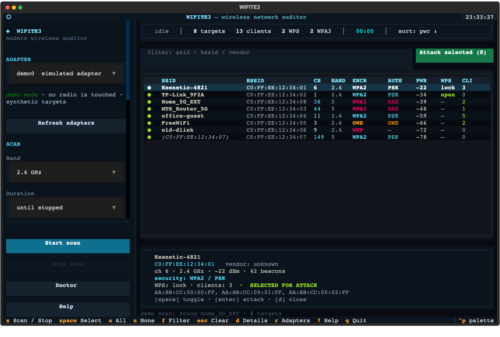

# Wifite3

**Современный TUI-аудитор Wi-Fi для Linux.** Внутри — весь боевой движок
[Wifite2](https://github.com/kimocoder/wifite2) (WPA/WPA2/WPA3, PMKID, WPS,
WEP, OWE, Evil Twin, dual-interface), снаружи — нормальный интерфейс, который
не рассыпается при установке.

> ⚠️ **Только для своих сетей.** Используйте Wifite3 только на сетях, которыми
> владеете или на тестирование которых есть письменное разрешение.
> Несанкционированный перехват трафика незаконен.

```
  ██╗    ██╗██╗███████╗██╗████████╗███████╗██████╗
  ██║    ██║██║██╔════╝██║╚══██╔══╝██╔════╝╚════██╗
  ██║ █╗ ██║██║█████╗  ██║   ██║   █████╗    █████╔╝
  ██║███╗██║██║██╔══╝  ██║   ██║   ██╔══╝   ██╔═══╝
  ╚███╔███╔╝██║██║     ██║   ██║   ███████╗███████╗
   ╚══╝╚══╝ ╚═╝╚═╝     ╚═╝   ╚═╝   ╚══════╝╚══════╝
```

## Скриншоты

Главный экран: сканирование, фильтр, сортировка, выбор целей и карточка сети.



Атака: прогресс по целям и живой вывод движка (PMKID, handshake, cracking).


## Что уже есть

- **Полный движок Wifite2** — 50k+ строк атакующих модулей скопированы в
  `wifite3/` и работают как раньше. Ничего не выброшено.
- **Новый Textual TUI** — таблица сетей с сортировкой и фильтром, выбор
  целей с клавиатуры, live-лог атаки, панель деталей, progress bar.
- **Живой ввод** — если движок спрашивает (`wordlist`, подтверждение), в TUI
  открывается модальное окно, а не ломается экран.
- **Кнопка Stop** — останавливает атаку через событие + `KeyboardInterrupt`
  в рабочем потоке и убивает дочерние процессы.
- **`--doctor`** — проверяет Linux, root, драйверы, адаптеры, monitor mode,
  `rfkill`, NetworkManager, Python-зависимости, wordlist, OUI-базу.
- **Установка без боли** — `install.sh` сам определяет Fedora / Ubuntu /
  Debian / Arch / openSUSE и ставит пакеты; Python-часть ставится в root-owned
  venv под `/opt/wifite3`, а не в системный Python или user-owned `pipx` (PEP 668).
- **`--demo`** — весь интерфейс и симуляция атаки без Wi-Fi карты. Работает
  даже на macOS — удобно для разработки и скриншотов.
- **`--classic`** — старый консольный режим Wifite2 со всеми флагами.

## Быстрый старт (Fedora)

```bash
git clone <repo> wifite3 && cd wifite3
./install.sh

sudo wifite3            # TUI
wifite3 --demo          # посмотреть интерфейс без карты
sudo wifite3 --doctor   # что не так с системой
```

`install.sh` ставит приложение в `/opt/wifite3/venv` и создаёт ссылку
`/usr/local/bin/wifite3`. Окружение принадлежит root, поэтому пользователь
не сможет подменить код, запускаемый затем через `sudo`.

Вручную, если не хотите скрипт:

```bash
sudo dnf install -y aircrack-ng iw iproute wireless-regdb \
  usbutils pciutils rfkill wpa_supplicant
sudo dnf install -y hashcat hcxdumptool hcxtools wireshark-cli \
  macchanger hostapd dnsmasq john cowpatty || true
# reaver/bully для WPS могут быть в RPM Fusion

python3 -m venv .venv
.venv/bin/pip install -e .
sudo .venv/bin/wifite3
```

## Управление

| Клавиша | Действие |
|---|---|
| `s` | старт / стоп сканирования |
| `space` | выбрать / снять выбор цели |
| `a` / `n` | выбрать все / снять всё |
| `enter` | атаковать выбранные (или все видимые) |
| `f` | фильтр по SSID / BSSID / вендору |
| `esc` | сбросить фильтр |
| `d` | полная карточка цели и клиенты |
| `r` | перечитать адаптеры |
| `?` | помощь |
| `q` | выход |

Клик по заголовку колонки — сортировка. В экране атаки `s` — остановить,
`esc` — назад (с подтверждением).

## Установка на другие дистрибутивы

```bash
# Debian / Ubuntu / Kali
sudo apt update
sudo apt install -y aircrack-ng iw iproute2 wireless-regdb usbutils \
  pciutils rfkill wpasupplicant hashcat hcxdumptool hcxtools tshark \
  macchanger hostapd dnsmasq john cowpatty reaver bully

# Arch
sudo pacman -S --needed aircrack-ng iw iproute2 wireless-regdb usbutils \
  pciutils rfkill wpa_supplicant hashcat hcxdumptool hcxtools wireshark-cli \
  macchanger hostapd dnsmasq john cowpatty reaver bully
```

`reaver`, `bully`, `bettercap` и часть WPS-инструментов могут отсутствовать в
официальных репозиториях — это не блокирует сканирование и WPA-атаки.
`--doctor` покажет точный список того, чего не хватает.

## Почему установка проще, чем у Wifite2

Типичные грабли Fedora:

1. **PEP 668** — `pip install` в системный Python запрещён. Wifite3 ставится
   в изолированный `/opt/wifite3/venv`, зависимости — через `dnf`.
2. **Пакет `wifite2` уже занят** — Python-пакет Wifite3 называется `wifite3`,
   поэтому конфликта импортов и `egg-info` нет.
3. **Нет `airodump-ng` / `iw` / `wireless-regdb`** — `install.sh` ставит их
   первыми, а `--doctor` объясняет, что именно отсутствует.
4. **Скрипт запускается не из папки репозитория** — OUI-база и wordlist
   ищутся через `importlib.resources`, а не относительно текущей директории.
5. **Сломанный терминал** — при отсутствии TTY автоматически включается
   классический режим; TUI можно отключить через `--classic`.

## Документация

- [docs/INSTALL.md](docs/INSTALL.md) — установка и решение проблем.
- [docs/ARCHITECTURE.md](docs/ARCHITECTURE.md) — как устроен проект.
- [docs/ROADMAP.md](docs/ROADMAP.md) — что дальше.

## Статус

Ранняя альфа (`0.1.0`). Движок Wifite2 стабилен; новый TUI активно
обкатывается. Присылайте логи из `--doctor --deep` и вывод `--classic -v`.

## Лицензия

GPL-2.0-only, как и Wifite2. См. [LICENSE](LICENSE) и [NOTICE](NOTICE).
